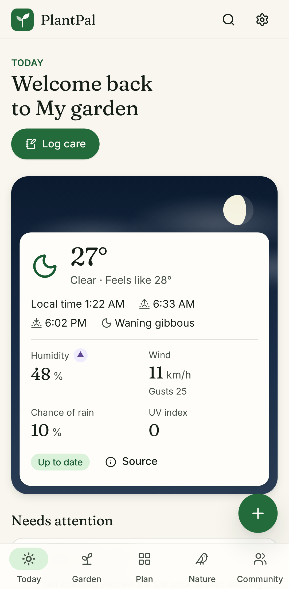
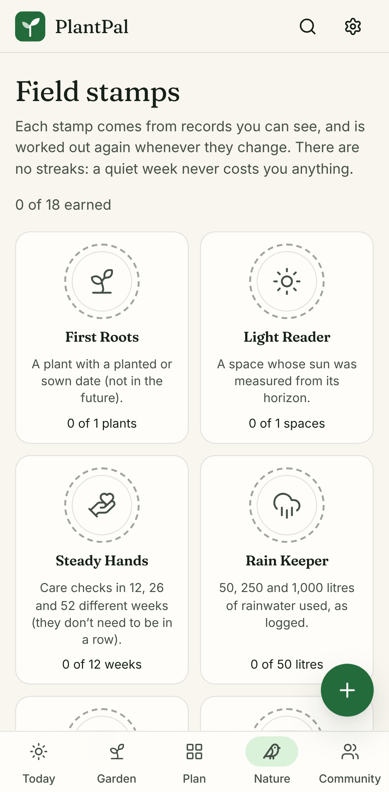
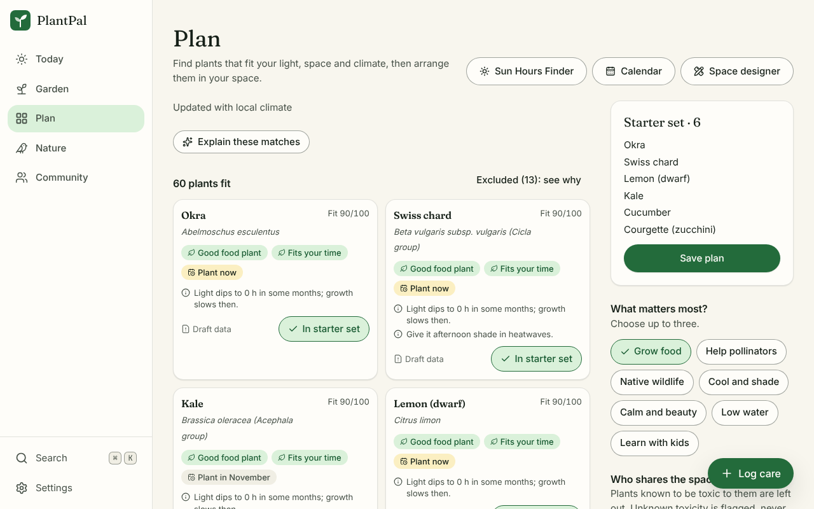
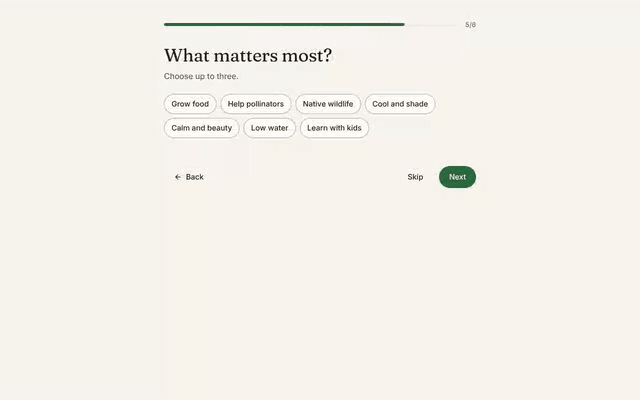
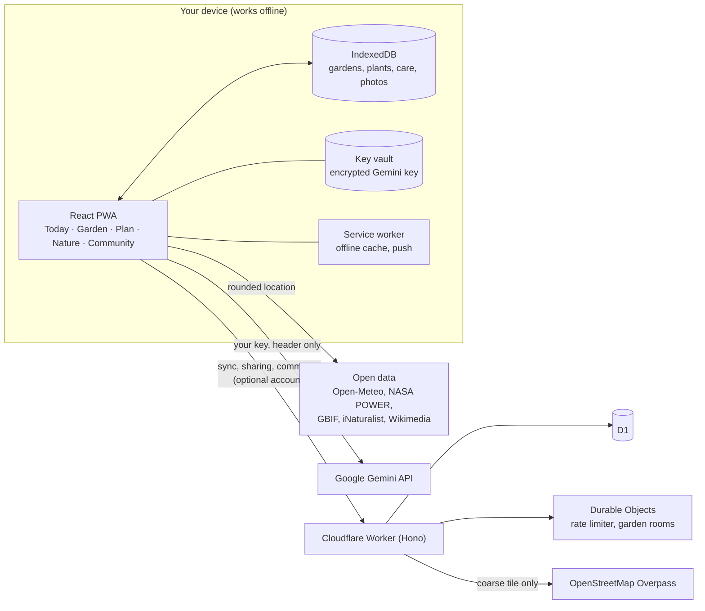

<div align="center">

# 🌿 PlantPal

### A garden companion for the space you actually have

[](https://github.com/Anupam0202/PlantPal/actions/workflows/ci.yml)
[](https://github.com/Anupam0202/PlantPal/actions/workflows/codeql.yml)
[](LICENSE)

_Grow the right plants for your balcony, yard or rooftop, keep them alive through heat, drought and frost, and measure what your space gives back to nature — using free, open environmental data and your own Gemini key._

</div>

---

## Why PlantPal

Most plant apps guess. PlantPal shows its working:

- **Evidence first.** Every fact carries its source, date and evidence grade (measured, modelled, catalogue, AI-suggested…). Nothing is presented as more certain than it is.
- **Local-first.** Your garden lives on your device and works offline. An account is optional and only needed to sync or share.
- **Bring your own key.** AI features use _your_ Gemini API key. It is encrypted on your device and sent only to Google — never to PlantPal servers. Everything that does not need AI works without a key.
- **For the environment.** Native and pollinator-friendly choices, invasive-species warnings, water-wise care and an honest impact ledger.

## What it does

| Area                       | Highlights                                                                                                                                          |
| -------------------------- | --------------------------------------------------------------------------------------------------------------------------------------------------- |
| Today                      | A care cockpit with "check by" watering, frost and heat guidance from your forecast, holiday catch-up and a kind weekly look back                   |
| Garden                     | Gardens, spaces, containers and plants; journal and photos with location data removed; health cases; photo identification; seed library and lineage |
| Plan                       | A 90-second first plan, a cited plant catalogue with reasons for every match, the Sun Hours Finder, Climate Fit and a Space Designer drawn to scale |
| Nature                     | Timed pollinator counts, Bloom Bridge, the Native & Invasive Lens, a green corridor map, harvest and pantry, an honest Impact Ledger                |
| Learn                      | Field stamps earned from your records (no streaks), six field lessons, your Garden Story and printable plant labels with QR codes                   |
| AI, with your own key      | An encrypted on-device key vault, model discovery, plan explanations, Quick Capture and a Garden Copilot that only suggests changes you confirm     |
| Accounts (optional)        | Passkeys, sync across devices, shared gardens with roles, plant-sitter links, live updates and Web Push                                             |
| Community (off by default) | A moderated feed, events, a Seed & Cutting Exchange and a map of active growers                                                                     |

Used the earlier PlantPal app in this browser? PlantPal finds that data, shows what it will bring over and saves a backup file first.

The full specification is in [`docs/specification.md`](docs/specification.md), feature status in [`docs/scope-ledger.md`](docs/scope-ledger.md), and short walkthroughs of each area in [`docs/guides/`](docs/guides/). Before a pilot launch, a few items are still open (a manual screen-reader review, mobile load time, and decisions only the owner can make): see [`docs/release-gates.md`](docs/release-gates.md).

## A look inside

Screenshots from the real app, with demo weather data.

<p>
  
  
</p>





More: [Garden](docs/screenshots/garden-desktop.png) · [Nature](docs/screenshots/nature-desktop.png)

## How it fits together



Decision records are in [`docs/adr/`](docs/adr/); the operations runbooks are in [`docs/runbooks/`](docs/runbooks/).

## Tech stack

| Area    | Choice                                                                                                                    |
| ------- | ------------------------------------------------------------------------------------------------------------------------- |
| Web app | React 19, Vite 8, TanStack Router + Query, Zustand, Tailwind CSS 4, Base UI, Motion                                       |
| Offline | Installable PWA (Workbox), IndexedDB via Dexie                                                                            |
| API     | Cloudflare Workers + Hono, D1 (Drizzle), R2, Durable Objects (free tier)                                                  |
| AI      | Google Gemini via `@google/genai`, with the user's own key and runtime model discovery                                    |
| Data    | Open-Meteo, NASA POWER, GBIF, iNaturalist, Wikipedia/Wikidata, OpenStreetMap (Overpass), OpenFreeMap — free, no paid tier |
| Maps    | MapLibre GL with OpenFreeMap tiles and H3 hexagons, loaded only on map pages                                              |
| Quality | TypeScript (strict), ESLint, Prettier, Vitest, Playwright + axe (WCAG 2.2 AA)                                             |

Pinned versions are recorded in [`docs/adr/0002-versions.md`](docs/adr/0002-versions.md).

## Getting started

### Prerequisites

- Node.js 22 or newer
- pnpm 10 (`corepack enable` picks up the version from `package.json`)

### Run it

```bash
git clone https://github.com/Anupam0202/PlantPal.git
cd PlantPal
pnpm install
pnpm dev          # web app on http://localhost:5173
```

No `.env` file and no API key are needed to run the app. Weather and place data come from free public services (Open-Meteo, NASA POWER); without internet access use demo data with `VITE_PROVIDERS=mock pnpm dev`. To route requests through the API Worker instead, run `pnpm dev:api` and set `VITE_API_BASE_URL=http://127.0.0.1:8787`. AI features use your own Gemini key, added inside the app under **Settings → AI**; get one free at [Google AI Studio](https://aistudio.google.com/app/apikey).

### Accounts, sync and push (optional)

The app works fully without them. To try accounts locally, run the Worker with a secret (see [`docs/guides/accounts-and-sync.md`](docs/guides/accounts-and-sync.md)):

```sh
cd apps/api && echo "BETTER_AUTH_SECRET=$(openssl rand -hex 32)" > .dev.vars
pnpm exec wrangler d1 migrations apply plantpal --local && pnpm exec wrangler dev
```

Open `http://localhost:8787` (passkeys need a domain such as `localhost`, not an IP address). `pnpm --filter @plantpal/api vapid:keys` makes Web Push keys.

The community (feed, events, Seed & Cutting Exchange, moderation) is **off by default**. It may be switched on for a public deployment only after the owner adopts [`docs/community-policy.md`](docs/community-policy.md) and names a moderator; to try it locally see [`docs/guides/community.md`](docs/guides/community.md).

### Useful scripts

| Command          | What it does                                                                  |
| ---------------- | ----------------------------------------------------------------------------- |
| `pnpm dev`       | Start the web app with hot reload                                             |
| `pnpm build`     | Production build of every package                                             |
| `pnpm test`      | Unit and component tests (Vitest)                                             |
| `pnpm e2e`       | End-to-end and accessibility tests (Playwright; run `pnpm build` first)       |
| `pnpm lint`      | ESLint with zero warnings allowed                                             |
| `pnpm typecheck` | TypeScript across the workspace                                               |
| `pnpm run ci`    | Everything CI runs: lint, typecheck, tests, build, secret scan, bundle budget |

The component gallery is at `/dev/design-system` in development and preview builds.

## Project layout

```
apps/
  web/        React PWA
  api/        Cloudflare Worker (Hono)
packages/
  ui/         design tokens and accessible components
  domain/     pure garden logic (units, dates, schedules, solar geometry)
  schemas/    shared Zod schemas
  providers/  environmental data adapters with provenance
  ai/         Gemini client, prompts and safety checks
  catalog/    curated plant catalogue
  db/         database schema
  sync/       offline sync engine
docs/         specification, decision records, guides, runbooks
tools/        build checks (secret scan, bundle budget, icons)
```

## Privacy and security

- No secrets in the client bundle; CI scans the build output for key patterns.
- Strict Content Security Policy with Trusted Types; the only policy allows same-origin script URLs (service worker and web workers).
- Your location is rounded before it leaves your device for public data providers. The community and the corridor map get only a hexagon of about 5 km², and the community map hides any hexagon with fewer than five active people.
- Accounts are optional and use passkeys only: no passwords, no email, and no IP addresses stored with sessions. Invitation and plant-sitter tokens are shown once, kept only as hashes, and travel in the URL fragment so they never reach server logs.
- Push notifications are end-to-end encrypted to your browser (RFC 8291) and sent only to known browser push services.
- Report vulnerabilities privately as described in [`SECURITY.md`](SECURITY.md).
- What is stored where, and who sees it: [`docs/privacy.md`](docs/privacy.md) (a draft until the owner publishes it).

## Contributing

Contributions are welcome — please read [`CONTRIBUTING.md`](CONTRIBUTING.md) and the [Code of Conduct](CODE_OF_CONDUCT.md).

## License

[MIT](LICENSE) © Anupam Roy

<div align="center">

_PlantPal's suggestions are guidance, not guarantees. Check local regulations before planting, and never eat or use a plant medicinally based on an app's identification._

</div>
